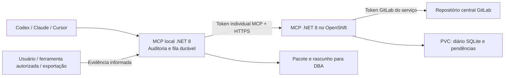

# DBFlow 0.2 — MCP .NET 8 e instalação por projeto

Controle automático de artefatos de banco por demanda, revisão, banco e ambiente. O agente recebe regras persistentes, hooks de auditoria e ferramentas MCP. O servidor está em C# / ASP.NET Core, com target `net8.0` e SDK oficial MCP. PowerShell/Python ficam responsáveis pela instalação e pelos hooks locais.

O MCP não conecta bancos de negócio, não executa SQL e não envia email. Desenvolvedor altera TI; DBA aplica HML/PRD. Registro no GitLab, preparo de pacote, envio informado e aplicação confirmada são fatos separados.

## Guia detalhado

Primeiro contato com o DBFlow? Comece pelo [manual passo a passo para iniciantes](docs/COMECE-AQUI.md): instalação, configuração, primeira demanda, entrega ao DBA, confirmação e recuperação de problemas, com comandos e resultados esperados.

Para entender a estrutura dos três repositórios, instalação e credenciais, hooks por cliente, ferramentas MCP, diagnóstico e o fluxo completo de uma demanda até o DBA, consulte [GUIA-DETALHADO.md](docs/GUIA-DETALHADO.md). Este pacote é o repositório do produto DBFlow; o ledger continua no repositório central de scripts da empresa.

## Arquitetura



No modo **Local**, o MCP .NET do projeto publica diretamente na API GitLab. No modo **Remote**, o MCP .NET local faz a auditoria dos arquivos e mantém a fila de solicitações; o serviço no OpenShift registra no GitLab. O token GitLab não precisa existir na máquina do desenvolvedor nesse modo. Cada endpoint `/mcp/<project_key>` tem configuração autorizada no servidor e tokens com projetos permitidos. O cliente verifica identidade do projeto, repositório e branch antes de enviar solicitações pendentes.

## Requisitos

- Projeto do desenvolvedor: runtime ASP.NET Core 8, Python 3.11+ e PowerShell para o assistente Windows.
- Compilação: SDK .NET capaz de compilar `net8.0`; Dockerfile usa SDK e runtime .NET 8. O pacote inclui `server/publish` já compilado, sem runtime embutido.
- OpenShift: namespace existente, registry de imagens, PVC com bloqueios SQLite locais/POSIX e permissão para Deployment, Service, Route, ConfigMap e Secret.

Mantido .NET 8 conforme solicitado. Na data desta entrega, seu suporte oficial terminou em **10/11/2026**; a adoção em produção precisa considerar esse ciclo de vida. [Política Microsoft](https://dotnet.microsoft.com/en-us/platform/support/policy/dotnet-core).

## Obter e preparar o produto

O ZIP de distribuição inclui o servidor já compilado em `server/publish`, mas não leva o runtime .NET: a máquina precisa do runtime ASP.NET Core 8. O repositório fonte ignora `server/publish/`; após clonar o fonte, compile uma vez com SDK .NET 8:

```powershell
git clone https://github.com/Lucasvor/dbflow.git
Set-Location .\dbflow
.\Build.ps1
```

Se o ZIP/fonte não tiver `server/publish/DbFlow.Server.dll`, `Install.ps1 -Apply` chama `Build.ps1` automaticamente. O preview sem `-Apply` não compila nem instala.

## Instalar agora e preencher as URLs depois

Execute na pasta deste pacote. Sem `-Apply`, o instalador mostra uma prévia.

```powershell
.\Install.ps1 -Project 'D:\caminho\MeuProjeto'
.\Install.ps1 -Project 'D:\caminho\MeuProjeto' -Interactive -Apply
```

O assistente pergunta modo, URL do repositório central, URL do MCP quando remoto e tipo de credencial GitLab. Enter permite deixar dados pendentes. A instalação conserva configurações alheias, usa blocos gerenciados, faz backups e não duplica entradas. Nenhuma configuração global dos clientes é alterada. O runtime é copiado para `.db-control/runtime/dotnet` e o comando MCP instalado é `dotnet .../DbFlow.Server.dll --stdio`.

| Cliente | Arquivos configurados |
|---|---|
| Codex | `AGENTS.md` ou override existente, MCP stdio e hooks nativos em `.codex/config.toml`, auditor em `.codex/agents` |
| Claude Code | `CLAUDE.md`, `.mcp.json`, hooks em `.claude/settings.json`, auditor |
| Cursor | regra `alwaysApply`, `.cursor/mcp.json`, `.cursor/hooks.json`, auditor |
| Projeto | `.db-control/project.json`, workflow, runtime, diário/fila local ignorados pelo Git |

Reabra o projeto e confirme que o cliente reconhece o MCP. Codex instala hooks nativos `SessionStart`, `PostToolUse` e `Stop` inline em `.codex/config.toml`; Claude Code e Cursor usam seus arquivos de hooks. No Codex, confie o projeto e revise/autorize os hooks pelo comando `/hooks`; a presença da configuração não significa que o cliente os ativou. O Codex segue o schema oficial de hooks; os hooks não executam com o cliente fechado. [Documentação oficial de hooks do Codex](https://learn.chatgpt.com/docs/hooks).

## Conectar um projeto ao serviço

O `project_key` fica em `.db-control/project.json` e precisa existir na configuração do servidor. Inicialmente deriva do nome da pasta; para padronizar clones com nomes diferentes, use `configure --project-key` antes do primeiro registro.

```powershell
.\Install.ps1 -Project 'D:\caminho\MeuProjeto' -Mode Remote `
  -RepositoryUrl 'https://gitlab.empresa.example/grupo/scripts-banco.git' `
  -McpUrl 'https://dbflow.apps.empresa.example/mcp/meuprojeto' -Apply
```

Para guardar o token MCP localmente, acrescente `-PromptToken`: a entrada fica oculta e o valor é criptografado com DPAPI para o usuário Windows, em `.db-control/local/credentials.dpapi.json`. Não passe o valor como argumento. A alternativa é fornecer `DBFLOW_SERVICE_TOKEN` por variável de ambiente/gerenciador corporativo ao iniciar o cliente. Variáveis do processo têm prioridade sobre DPAPI; reabra o cliente após rotação.

No modo Local, use `-Mode Local -RepositoryUrl ...`; `-PromptToken` guarda a credencial **GitLab**, enquanto `DBFLOW_GITLAB_TOKEN` é a alternativa por ambiente. DPAPI não é portátil entre contas/máquinas. Linux deve usar o mecanismo de segredos do ambiente.

GitLab instalado em subdiretório: acrescente `-GitLabInstanceUrl 'https://host/gitlab'` para separar corretamente o prefixo da instância do caminho do projeto. URLs HTTPS com subgrupos, `.git` e barra final são normalizadas; links de arquivos/branches e credenciais embutidas são recusados.

## Preparar o servidor para OpenShift

O modo Server configura o registro e gera os recursos; não executa `oc`, não faz push e não publica no cluster.

```powershell
.\Install.ps1 -Project 'D:\configuracoes\MeuProjeto' -Mode Server `
  -RepositoryUrl 'https://gitlab.empresa.example/grupo/scripts-banco' `
  -Namespace 'minha-equipe' -RouteHost 'dbflow.apps.empresa.example' `
  -Image 'registry.empresa.example/minha-equipe/dbflow:0.2.0' `
  -OutputDirectory '.\deploy-gerado' -Apply
```

Resultado: `deployment.json` (List Kubernetes com ConfigMap, PVC, Deployment, Service e Route), `server-config.json`, `secret-inputs.json` e `Apply-Secrets.ps1`. Nenhum desses arquivos contém valores de credenciais. URLs ausentes ficam explicitamente pendentes; `example.invalid` não é um endereço funcional.

O Deployment usa uma réplica com estratégia **Recreate** e PVC de 2 GiB, porta 8080, filesystem raiz somente leitura, volumes para dados/tmp, execução sem root, capacidades removidas e probes de processo/armazenamento. Não fixa `runAsUser`: o OpenShift pode atribuir UID arbitrário. O PVC deve ser gravável pelo grupo atribuído pela SCC; valide a StorageClass da empresa. Não escale para múltiplos escritores sem mudar a persistência/coordenação. GitLab indisponível não derruba a readiness: operações são preservadas e mostram sincronização pendente.

Para adicionar projetos à mesma instância, execute o modo Server para cada pasta com **o mesmo OutputDirectory**. A geração preserva os projetos anteriores e as contas em `secret-inputs.json`. Antes de aplicar, confira os `project_key` e o escopo de cada conta. Cada projeto pode apontar para o mesmo repositório central ou para outro autorizado. Não repointe um diário existente para outro registro sem uma migração explícita.

Na máquina com acesso ao registry/cluster:

```powershell
docker build -t registry.empresa.example/minha-equipe/dbflow:0.2.0 .
docker push registry.empresa.example/minha-equipe/dbflow:0.2.0
oc project minha-equipe
# Confira secret-inputs.json: atores, projetos permitidos e nomes das variáveis.
.\deploy-gerado\Apply-Secrets.ps1
oc apply -f .\deploy-gerado\deployment.json
oc rollout status deployment/dbflow
```

`Apply-Secrets.ps1` lê variáveis existentes ou pede valores ocultos, enviando o Secret por stdin ao `oc`. Não cria arquivo temporário nem usa valores secretos nos argumentos. No primeiro uso, a tentativa de reiniciar um Deployment ainda inexistente gera aviso; aplique o manifesto em seguida. Em rotações posteriores, o script reinicia o Deployment. Também é possível criar `dbflow-secrets` com um gerenciador corporativo, sem usar esse script. Os tokens MCP precisam ter pelo menos 32 caracteres aleatórios, distintos por identidade. O arquivo `secret-inputs.json` é a lista completa de contas que o script publicará.

A Route usa TLS edge. Se a política da empresa exigir TLS também entre router e pod, adapte certificado/listener e Route reencrypt antes de implantar. Para CA GitLab privada, use `-CaBundle caminho\trust-bundle.pem` com o bundle PEM de confiança aprovado; isso configura `SSL_CERT_FILE`. Não há opção de ignorar certificados. As regras de UID e porta seguem a documentação [OpenShift](https://docs.redhat.com/en/documentation/openshift_container_platform/4.21/html/images/creating-images) e [.NET 8](https://learn.microsoft.com/en-us/dotnet/core/compatibility/containers/8.0/aspnet-port).

## Autenticação do GitLab

| Opção | Configuração | Origem do valor |
|---|---|---|
| PAT individual | `-Authentication private_token` | DPAPI/ambiente local ou Secret servidor |
| Token de projeto/grupo | `-Authentication private_token` | Preferencialmente Secret do serviço |
| Access token OAuth já obtido | `-Authentication oauth_access_token` | Ambiente/Secret mantido pelo provedor externo |

As opções usam respectivamente `PRIVATE-TOKEN` ou `Authorization: Bearer`, conforme a [API GitLab](https://docs.gitlab.com/api/rest/authentication/). O repositório e a branch devem existir; o token precisa de escopo e papel que permitam commits nessa branch (geralmente `api` nos tokens tradicionais). Deploy token não serve para essa API. Não foi implementado login OAuth em navegador, renovação automática ou autenticação Git por SSH. Expiração deixa a sincronização pendente, sem declarar sucesso.

## Bancos, demandas e confirmações

Mapeie bancos lógicos e ambientes, sem connect strings:

```powershell
python .\dbctl.py --project 'D:\caminho\MeuProjeto' map-database `
  --database PRO --engine sqlserver --environment HML --instance-alias sql-hml --physical-name PRO
```

Repita para PRI, TI/PRD e outros motores. No modo remoto, configure os mapeamentos na pasta usada para gerar o servidor e gere/aplique novamente. O serviço é a autoridade dos destinos; o status devolve os fingerprints atuais. Oracle/Mongo e outros motores são aceitos como artefatos; não há driver nem interpretação semântica dos scripts.

O agente identifica a demanda pelo contexto, classifica os arquivos candidatos e registra revisões imutáveis com scripts completos, hashes, destinos, dependências e procedimento de verificação. O ledger fica em `dbflow/projects/<project_key>/events/`; `demands/<demand_id>/head.json` guarda o ID da revisão corrente. Na atualização concorrente, o servidor usa o `last_commit_id` como metadado devolvido pela API GitLab para controle otimista da gravação (ele não está dentro do JSON `head.json`). Há gravação na branch configurada, sem MR automático por demanda. Sobreposição do mesmo objeto é sinalizada; não há merge semântico automático de SQL.

Uma entrega congela revisões e destinos, ordena dependências e gera scripts, manifesto e rascunho de email. Confirmações vinculam revisão, banco, ambiente, fingerprint e etapas. `manual_applied`, evidência de execução e estado observado continuam separados. R1 confirmada não confirma R2. Snapshots vêm de ferramentas autorizadas do usuário ou exportações e declaram cobertura; comparação textual não prova execução nem exclusão de objetos fora da cobertura.

Reinstalação conserva o SQLite da versão 0.1, hashes/IDs e confirmações existentes. Pacotes antigos preservam manifestos semanticamente iguais e rascunhos locais; scripts alterados continuam recusados. Regras/hook são orientação e detecção, não garantia absoluta de que uma IA nunca esquecerá uma chamada. Auditoria e evidência externa continuam necessárias.

## Compilar e verificar

```powershell
.\Build.ps1
python -m unittest discover -s tests -v
dotnet run --project .\server-tests\DbFlow.Server.Tests.csproj
python .\dbctl.py --project 'D:\caminho\MeuProjeto' doctor
python .\dbctl.py --project 'D:\caminho\MeuProjeto' status
```

Os testes Python incluem integração com o executável .NET e regressão do protótipo. O projeto C# testa o adaptador GitLab com HTTP simulado, sem rede externa. `dbctl.py demo` permanece uma demonstração da referência Python; não é validação do servidor implantado. O código Python antigo de protocolo está preservado para testes de regressão; os clientes instalados e o serviço HTTP usam .NET.

O pull do ledger ainda tem limite de 10000 eventos por projeto e percorre o registro completo. Para escala maior, será necessário índice incremental. O processo não tem observação contínua de email/banco nem reconciliador agendado. Consulte `VALIDACAO.md` para evidências e limites desta entrega.
