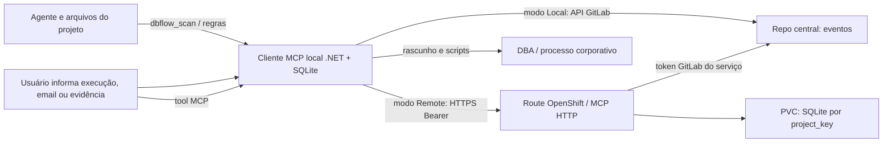
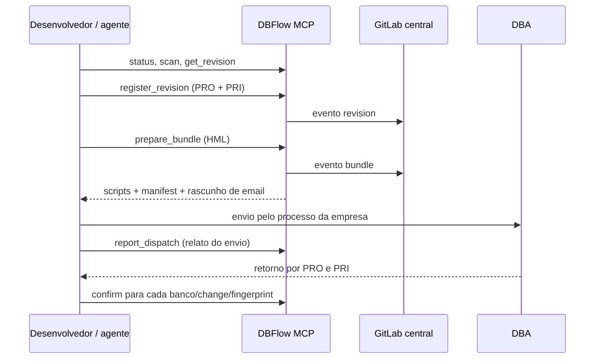

# Guia detalhado do DBFlow 0.2

Este guia descreve o código disponível em [Lucasvor/dbflow](https://github.com/Lucasvor/dbflow). A implantação no ambiente da empresa é uma etapa separada. O DBFlow organiza scripts, revisões, pacotes de entrega e evidências entre três repositórios distintos. Seu serviço é MCP e diário de eventos; não é executor de SQL, caixa de email, nem monitor contínuo.

## 1. Os três repositórios e o que cada um guarda

### Repositório do produto DBFlow

Este é o repositório fonte do produto no GitHub. Nele ficam servidor, instalador, templates e testes. Uma visão da árvore versionável (sem `bin/obj` e dependências de build):


```text
DBFlow/
├── dbctl.py                         # entrada CLI Python para instalação/auditoria
├── Install.ps1, Build.ps1           # assistente Windows e compilação do MCP .NET
├── Dockerfile
├── dbflow/                          # instalador, configuração, auditoria e compatibilidade
├── server/                          # servidor MCP C# .NET 8 e ferramentas
│   ├── Program.cs                   # stdio local e HTTP no serviço
│   ├── Runtime.cs, Control.cs       # despacho MCP e regras de domínio
│   ├── Store.cs                     # diário SQLite local/servidor
│   ├── GitLab.cs, Remote.cs         # integração GitLab e outbox remota
│   └── tools.json                   # schemas MCP
├── templates/                       # workflow/instruções e exemplo de mapa
├── openshift-example/               # exemplos de configuração e recursos gerados
├── server-tests/, tests/            # verificações C# e regressão Python
├── docs/GUIA-DETALHADO.md
└── README.md, VALIDACAO.md
```

A distribuição ZIP inclui `server/publish` compilado, enquanto o repositório fonte ignora essa pasta. Ao clonar a fonte, compile com `.\Build.ps1` (SDK .NET 8). Também é possível deixar o instalador fazer isso: `Install.ps1 -Apply` chama `Build.ps1` se `server/publish/DbFlow.Server.dll` estiver ausente; o preview sem `-Apply` não compila. O runtime .NET ASP.NET Core 8 ainda precisa estar instalado na máquina.

A UI do cliente não roda no repositório central nem no OpenShift. O executável local é iniciado por stdio no processo do cliente. Python é usado no instalador, CLI de diagnóstico/auditoria e compatibilidade; o servidor MCP de produção é C#/.NET 8.

### Repositório de cada aplicação

O instalador modifica a pasta do projeto da aplicação. Regras, MCP, hooks configurados pelo cliente e estado local ficam aqui; nenhum deles é o repositório GitLab central de eventos:


```text
Aplicacao/
├── AGENTS.md                         # regra persistente do Codex
├── CLAUDE.md                         # regra persistente do Claude Code
├── .codex/config.toml                 # MCP stdio + hooks Codex
├── .codex/agents/dbflow-auditor.toml   # auditor independente do Codex
├── .claude/settings.json              # hooks Claude Code
├── .claude/agents/dbflow-auditor.md    # auditor independente do Claude Code
├── .mcp.json                          # servidor MCP Claude
├── .cursor/hooks.json                 # hooks Cursor
├── .cursor/mcp.json                   # servidor MCP Cursor
├── .cursor/rules/dbflow.mdc           # regra persistente alwaysApply
├── .cursor/agents/dbflow-auditor.md   # auditor independente do Cursor
├── .db-control/
│   ├── project.json                   # project_key, destinos lógicos, URLs/padrões
│   ├── WORKFLOW.md                    # procedimento persistente do agente
│   ├── runtime/                       # cópia do cliente DBFlow e runtime .NET publicado
│   ├── local/                         # journal.sqlite3, credenciais DPAPI/outbox (ignorado)
│   ├── backups/                       # arquivos substituídos pelo instalador
│   └── install-manifest.json          # propriedade dos arquivos instalados
└── .gitignore                          # ignora estado local/segredos/backup
```

A árvore exata depende dos clientes selecionados e das configurações já existentes. O instalador faz merge gerenciado, backup e evita apagar configuração alheia. Não há configuração global do Codex/Claude/Cursor. O `.db-control/local` é estado por checkout/máquina; não deve ser commitado nem copiado como substituto do diário central.

### Repositório central de scripts e ledger no GitLab

Este é o repositório já usado pela empresa para centralizar artefatos. O código grava em `dbflow/projects/<project_key>/events/<event-id>.json`; o `project_key` separa cada configuração autorizada. Para revisão, também mantém `dbflow/projects/<project_key>/demands/<demand_id>/head.json`, cujo conteúdo guarda somente o ID da revisão corrente. Na gravação concorrente, o servidor usa o `last_commit_id` como metadado devolvido pela API GitLab para controle otimista; esse valor não está no JSON do ponteiro. O código não exige uma árvore paralela `procs/` nem a cria automaticamente:

```text
scripts-banco/                       # repositório central existente
└── dbflow/
    └── projects/
        └── <project_key>/
            ├── demands/
            │   └── <demand_id>/head.json # revisão corrente
            └── events/
                ├── <event-id>.json       # um evento por arquivo/commit
                ├── <event-id>.json
                └── ...                   # revision, bundle, snapshot, confirmação etc.
```

Cada evento tem ID, projeto, tipo, timestamp e dados; revisão carrega scripts completos e hash. Os arquivos de entrega são exportados pelo `dbflow_prepare_bundle` como conteúdo retornado ao cliente e não significam que o DBA já aplicou o script. O servidor sincroniza consultando e publicando eventos GitLab na branch configurada. O limite de pull hoje é 10.000 eventos por projeto.

## 2. Visão de funcionamento



- **Local:** o cliente MCP local mantém o journal SQLite e fala diretamente com a API GitLab. Token GitLab pode estar no ambiente ou no cofre DPAPI do usuário Windows.
- **Remote:** o cliente local lê/audita arquivos e mantém solicitações pendentes localmente; transmite ao serviço OpenShift por HTTPS com token MCP individual. O serviço aplica a configuração autorizada do projeto, persiste no PVC e fala com GitLab. O token GitLab fica no Secret do serviço, não no PC do desenvolvedor.
- O serviço não conecta a SQL Server/Oracle/Mongo. O mapa só associa chaves lógicas (ex. `PRO`) a aliases e nomes físicos, e gera fingerprint para evitar confirmar em outro destino por engano.

## 3. Instalação e quem configura o quê

### Administrador / responsável pela plataforma

1. Define repositório/branch central e projeto autorizado, `project_key`, destinos (PRO, PRI; TI, HML, PRD) e hostname da Route.
2. Executa o modo Server para gerar manifesto e configurações, revisa projeto e contas autorizadas, constrói e envia imagem e aplica recursos. O instalador **não** chama `docker`, `oc`, não publica imagem e não implanta cluster.
3. Cria `DBFLOW_SERVICE_TOKENS` e `DBFLOW_GITLAB_TOKEN` no Secret/gerenciador da plataforma. Cada identidade MCP precisa de token aleatório de 32+ caracteres, distinto, e lista explícita de projetos. Token GitLab requer escrita na branch central. `Apply-Secrets.ps1` solicita segredo oculto ou usa variáveis existentes e passa Secret por stdin ao `oc`.
4. Valida PVC `ReadWriteOnce` single-writer, gravabilidade pela SCC e acesso à CA GitLab. O manifesto gera PVC de 2Gi, Deployment de uma réplica com estratégia Recreate, Service e Route TLS edge. Readiness valida armazenamento; não prova alcance ao GitLab. Multi-réplica não é suportada para o mesmo diário SQLite.
5. Informa ao desenvolvedor o endereço MCP final: `https://<route-host>/mcp/<project_key>`, token MCP individual e identidade autorizada. O endereço real permanece pendente até a infraestrutura fornecer DNS/Route.

Comando de geração do pacote (substitua valores e rode no host com acesso ao registry/cluster):

```powershell
.\Install.ps1 -Project 'D:\configuracoes\MeuProjeto' -Mode Server `
  -RepositoryUrl 'https://gitlab.empresa.example/grupo/scripts-banco' `
  -Namespace 'equipe' -RouteHost 'dbflow.apps.empresa.example' `
  -Image 'registry.empresa.example/equipe/dbflow:0.2.0' `
  -OutputDirectory '.\deploy-gerado' -Apply
```

Construa/push a imagem conforme a política da empresa; depois configure Secret e aplique `deployment.json`. Exemplo de sequência documentada no README:

```powershell
docker build -t registry.empresa.example/equipe/dbflow:0.2.0 .
docker push registry.empresa.example/equipe/dbflow:0.2.0
oc project equipe
.\deploy-gerado\Apply-Secrets.ps1
oc apply -f .\deploy-gerado\deployment.json
oc rollout status deployment/dbflow
```

O modo Server grava `deployment.json`, `server-config.json`, `secret-inputs.json` e `Apply-Secrets.ps1` no diretório de saída. Os JSONs descrevem quais nomes de segredo são necessários; valores secretos não devem entrar em arquivo versionado.

### Desenvolvedor / dono do checkout

1. Obtém o pacote DBFlow e roda o instalador no checkout da aplicação. Pode usar modo interativo deixando URLs pendentes enquanto espera os dados oficiais:

```powershell
.\Install.ps1 -Project 'D:\projetos\MinhaAplicacao' -Interactive -Apply
```

2. Seleciona **Remote** se o administrador publicou o MCP OpenShift; informa URL do repositório e URL completa `https://<host>/mcp/<project_key>`. Para credencial MCP, use `-PromptToken` e informe token oculto (guardado via DPAPI para a conta Windows) ou configure `DBFLOW_SERVICE_TOKEN` no ambiente do cliente. Reabra o aplicativo depois de alterar ambiente/credencial.
3. Se o projeto ainda está sem os endereços, pode instalar agora e preencher depois. Não invente endpoint. Após obter URL/token, rode novamente com `-Mode Remote -RepositoryUrl ... -McpUrl ... -Apply` e `-PromptToken`, ou defina variável de ambiente.
4. No modo Local, defina os mapas com a CLI. No modo Remote, peça à plataforma que configure os mapas na pasta usada pelo modo Server e gere/aplique novamente a configuração: o servidor é a autoridade dos destinos. O mapa é só metadado: nenhum segredo SQL é solicitado.
5. Reabra o projeto, aprove MCP/hooks conforme os controles nativos do cliente e rode diagnóstico.

Exemplo de configuração remota e mapa:

```powershell
.\Install.ps1 -Project 'D:\projetos\MinhaAplicacao' -Mode Remote `
  -RepositoryUrl 'https://gitlab.empresa.example/grupo/scripts-banco' `
  -McpUrl 'https://dbflow.apps.empresa.example/mcp/minha-aplicacao' `
  -PromptToken -Apply

python .db-control\runtime\dbctl.py --project . map-database `
  --database PRO --engine sqlserver --environment TI --instance-alias sql-ti --physical-name PRO
```

O exemplo `map-database` altera a configuração local. Em Remote, esse comando deve ser executado pela plataforma na pasta usada pelo modo Server, seguido da geração e aplicação da configuração. Repita o mapeamento para PRO/PRI e TI/HML/PRD conforme destinos reais. Depois consulte `status` para fingerprints. TI é ambiente de trabalho do desenvolvedor; HML/PRD são aplicados por DBA segundo processo institucional.

## 4. O que o agente vê: hooks, regra e ferramentas

As instruções persistentes são lidas pelo agente automaticamente no contexto do projeto; o usuário não precisa invocar uma skill manualmente. Elas orientam o agente a consultar status, auditar arquivos, registrar revisões e recuperar entregas antigas. Hooks fazem chamadas locais de auditoria/varredura nos eventos configurados. Em modo Remote, os pedidos ficam em outbox no projeto e são sincronizados quando há uma chamada MCP (por exemplo status ou registro); não há daemon/retry contínuo depois que o cliente fecha. Hooks não vigiam todo o computador; atuam em eventos/sessão do cliente e escopo de arquivo configurado. Não enxergam mudanças feitas em SSMS fora da sessão nem caixa de email.

- **Claude Code:** instalador grava MCP em `.mcp.json`, instruções em `CLAUDE.md`, auditor MCP e eventos de hook em `.claude/settings.json`. Hooks chamam `python .db-control/runtime/dbctl.py --project . hook` nos eventos do cliente.
- **Cursor:** MCP em `.cursor/mcp.json`, regra com `alwaysApply`, auditor e `.cursor/hooks.json`; cobertura depende dos eventos e versão do Cursor instalados.
- **Codex:** regra/instruções no `AGENTS.md`/override e MCP stdio em `.codex/config.toml`; o instalador também acrescenta hooks nativos no bloco gerenciado desse arquivo: `SessionStart`, `PostToolUse` (matcher `.*`) e `Stop`. `SessionStart`/`PostToolUse` executam auditoria; `Stop` pode devolver `decision=block` com `reason` para pedir continuação quando há pendência; `stop_hook_active` limita o loop. A implementação foi verificada com `codex-cli 0.153.4` e `hooks stable`; veja a [documentação oficial de hooks do Codex](https://learn.chatgpt.com/docs/hooks). é necessário confiar o projeto e revisar/autorizar o hash do hook via `/hooks`. A presença no arquivo, por si só, não ativa o hook.

O MCP anuncia estas 12 ferramentas (`server/tools.json`):

| Ferramenta | Uso |
|---|---|
| `dbflow_status` | Estado, revisões, pendências, destinos/fingerprints e sincronização. |
| `dbflow_scan` | Candidatos em arquivos locais segundo `watch.include`; não varre banco. |
| `dbflow_register_revision` | Registra scripts imutáveis completos e tenta sincronizar evento. |
| `dbflow_get_revision` | Recupera scripts e dependências de revisão existente. |
| `dbflow_prepare_bundle` | Congela revisões/destino; gera scripts, manifesto e rascunho `email.txt`. |
| `dbflow_get_bundle` | Recupera pacote, arquivos e relatos de despacho já existentes. |
| `dbflow_report_dispatch` | Registra informação do usuário de que o email foi enviado; não envia. |
| `dbflow_confirm` | Anota aplicação manual, recibo de execução, sucesso de estado ou falha para IDs/destino exatos. |
| `dbflow_record_snapshot` | Guarda definições exportadas/coletadas pelo usuário e escopo coberto. |
| `dbflow_exclude_candidate` | Exclui um hash exato de candidato com razão; edição volta a aparecer. |
| `dbflow_abandon_local_revision` | Preserva como abandonada revisão local não publicada, após conflito. |
| `dbflow_cancel_remote_request` | Para retentativa local de requisição rejeitada/pendente, preservando histórico. |

Uma chamada é a invocação da ferramenta pelo cliente MCP, com os argumentos descritos no schema; o nome acima é exato. Exemplo de `dbflow_status` sem argumentos: solicite ao cliente “Consulte `dbflow_status` agora e mostre a sincronização, demandas e destinos PRO/PRI”. Exemplo de registro: “Analise os scripts alterados para a demanda ABC-123, confirme se PRO e PRI estão envolvidos, recupere a revisão pai e registre uma revisão completa em `dbflow_register_revision`; não declare sincronizado se o retorno estiver pending.” Exemplo de retomada: “Retome ABC-123: chame `dbflow_status` filtrando `demand_id`, recupere a revisão com `dbflow_get_revision`, recupere o pacote anterior com `dbflow_get_bundle` e liste o que falta por banco e ambiente antes de criar qualquer novo pacote.”

Exemplos dos argumentos JSON que o cliente passa à chamada MCP (IDs e SQL abaixo são fictícios; adapte ao retorno real de status):

```json
{
  "operation_id": "op-chg4821-pro-r1",
  "demand_id": "CHG-4821",
  "title": "Ajuste da tabela de pedidos",
  "parent_revision": null,
  "changes": [
    {
      "id": "chg4821-pro-001",
      "database": "PRO",
      "object": "dbo.Pedido:table",
      "kind": "alter_table",
      "filename": "001_altera_pedido.sql",
      "script": "ALTER TABLE dbo.Pedido ADD Observacao varchar(200) NULL;",
      "verification": "Consultar sys.columns e confirmar dbo.Pedido.Observacao e tipo varchar(200).",
      "source_path": "database/001_altera_pedido.sql",
      "source_sha256": "<SHA-256 dos bytes UTF-8 exatos do arquivo>",
      "depends_on": []
    }
  ],
  "dependencies": []
}
```

A chamada é `dbflow_register_revision` com esse objeto como `arguments`. Para congelar explicitamente essa revisão para HML, a chamada seguinte usa operation ID próprio:

```json
{
  "operation_id": "op-chg4821-hml-bundle1",
  "revision_ids": ["r-<id-de-revisao-retornado>"],
  "environment": "HML"
}
```

O cliente invoca `dbflow_prepare_bundle` com o segundo objeto; não invente o ID de revisão, bundle ou fingerprint: use o retorno do MCP. Para status filtrado, a chamada `dbflow_status` recebe `{"demand_id":"CHG-4821","offset":0,"limit":50}`.
Para diagnóstico sem o cliente, comandos exatos:

```powershell
python .db-control\runtime\dbctl.py --project . doctor
python .db-control\runtime\dbctl.py --project . status
python .db-control\runtime\dbctl.py --project . audit
```

O comando `doctor` separa configuração e atividade registrada: `client_hooks.<cliente>.configured` informa se encontrou configuração no arquivo do cliente; `last_helper_invocation` registra somente `{event,last_seen}` da última chamada ao helper; `codex_hooks` explica a situação Codex, inclusive `disabled_by_config` se `features.hooks=false` ou exigência de projeto confiável e aprovação em `/hooks`. O timestamp prova apenas que o helper rodou (pode ter sido acionado manualmente); não prova que Codex CLI/desktop disparou ou aceitou o hook. Confira `.db-control/install-manifest.json` para arquivos/versões instalados, `.db-control/project.json` para modo, endpoint e `project_key`, configuração específica do cliente acima para MCP/hooks, e `doctor`/`audit` para runtime, configuração e candidatos. Em Remote, a configuração local deve mostrar `remote_url`; no Claude/Cursor procure os comandos nos arquivos de hook correspondentes. Para Codex, verifique `.codex/config.toml` quanto ao bloco MCP e hooks DBFlow (`SessionStart`, `PostToolUse`, `Stop`) e revise/autorize os hooks na interface do cliente; o projeto precisa estar confiável. Se o cliente não mostrar o MCP, reinicie-o, confira confiança do workspace, caminho/runtime .NET e aprovação nativa, depois rode `doctor`.

## 5. Exemplo completo: demanda PRO e PRI, do TI ao DBA

1. **Identificar a demanda:** agente consulta `dbflow_status`, filtra/reconhece o ID da demanda (ex. `CHG-4821`), analisa candidatos via `dbflow_scan`. Se já há revisão, recupera com `dbflow_get_revision`; não reutiliza título como ID nem cria outra entrega automaticamente.
2. **Entender o escopo:** uma alteração de tela pode exigir mudanças em PRO e PRI. O agente identifica cada banco lógico separadamente, objeto com schema/tipo, scripts e dependências. Com ferramentas que o usuário já autorizou, pode obter definição anterior; DBFlow não fornece conexão. Sem baseline, registra essa limitação.
3. **Registrar em TI:** desenvolvedor valida/aplica conforme processo local no banco TI e mantém os arquivos dos scripts no checkout. O agente invoca `dbflow_register_revision` com `operation_id` estável para retry, `demand_id`, `title`, `parent_revision` atual e `changes[]`. Cada change precisa identificar `id`, `database` (`PRO` ou `PRI`), `object`, `kind`, `filename`, script SQL integral e `verification`; inclui dependências e hash de bytes se vincula arquivo. Retorno `queued/pending` quer dizer diário local aguardando publicação; `synced` quer dizer evento no GitLab, não execução.
4. **Preparar HML:** após revisar scripts/estado, agente chama `dbflow_prepare_bundle` com operation id novo, IDs explícitos das revisões e `environment: HML`. Operação falha se destino não está mapeado, dependência não selecionada/não confirmada, revisão conflitante ou objetos sobrepostos sem reconciliação. Retorno contém `bundle_id`, manifesto, arquivos e `email.txt` rascunho. O pacote registra targets distintos para PRO/HML e PRI/HML, com fingerprints.
5. **Enviar ao DBA:** usuário revisa/anexa scripts e envia por seu processo institucional. DBFlow não tem integração SMTP nem lê email. Só depois que o usuário informa envio, agente chama `dbflow_report_dispatch` com `bundle_id`, referência de email/ticket e `sent_at`. Isso marca relato de despacho, nunca aplicação.
6. **Aguardar e retomar:** dias depois, agente consulta novamente status e usa `dbflow_get_bundle` para reabrir o mesmo pacote, identificar relatórios e pendências por banco. Não cria bundle duplicado. DBFlow não agenda polling nem acompanha caixa de entrada; retomada acontece quando pessoa/agente volta a executar.
7. **Registrar resposta DBA:** para cada banco e change IDs, agente chama `dbflow_confirm` com `kind: manual_applied` quando há relato humano, `execution_succeeded` quando executor/recibo comprova execução, `failed` em falha, ou `state_matches/state_differs` para observação autorizada do estado. Inclui evidência, hora, fingerprint exato e `bundle_id` correspondente. PRO sucesso não implica PRI; HML não implica PRD. `state_matches` é evidência de condição observada, não prova que aquele script específico foi executado.
8. **Promover PRD:** só quando processo aprovar, preparar bundle específico para PRD e repetir despacho e confirmação de maneira independente. Nenhuma confirmação migra de HML para PRD nem para revisões futuras.

### Pendência paralela: R1 enviada enquanto nasce R2

Considere uma demanda cujo pacote **R1** contém mudanças para PRO e PRI em HML. O desenvolvedor envia R1 ao DBA e, antes de receber resposta, identifica outra alteração e registra **R2** como revisão posterior da mesma demanda. Dias depois, o DBA confirma que aplicou R1 em PRO/HML; ainda não respondeu sobre PRI. O agente deve confirmar o pacote R1 com seu `bundle_id`, `revision_id`, IDs de mudança e fingerprints originais. Não deve atualizar o pacote enviado nem transferir essa confirmação para R2.

| Revisão | Banco lógico | HML depois do retorno | PRD | Significado |
|---|---|---|---|---|
| R1 | PRO | `manual_applied` (confirmada) | `pending` | Confirmação cobre somente R1/PRO/HML e o fingerprint informado. |
| R1 | PRI | `pending` | `pending` | O envio do mesmo pacote não prova aplicação em PRI. |
| R2 | PRO | `pending` | `pending` | Nova revisão; não herda aplicação/observação de R1. |
| R2 | PRI | `pending` | `pending` | Nova revisão; segue pendente mesmo que DBA venha a confirmar R1/PRI. |

Essa matriz é independente por revisão, banco e ambiente. Se depois o DBA confirmar R1 em PRI/HML, somente aquela célula passa a confirmada. Preparar R2 para HML ou PRD exige seleção explícita de R2, validação de dependências e um novo bundle; confirmação de R1 não equivale à promoção de R2. Confirmações em PRD são registros separados das de HML.


## 6. Retomada, erros e fronteiras

- `not_configured`: URL/projeto GitLab ausente; `pending`: falha de transporte/publicação ou fila local; não declare sincronizado. Corrija endpoint/credencial/rede e consulte status para tentar sincronizar.
- Conflito de `parent_revision`: sincronize e compare revisões antes de reconciliar. Não descarte revisão com despacho/confirmação. `dbflow_abandon_local_revision` só serve para revisão não publicada sem evidência de entrega; preserva o evento e exige motivo.
- Requisição remota inválida fica `rejected`; corrija os argumentos e use novo `operation_id`. `dbflow_cancel_remote_request` interrompe retries locais, não desfaz o que servidor já processou.
- Pacote é imutável: mudança posterior requer nova revisão/pacote; referências antigas permanecem históricas.
- Comparação de snapshot é textual, sem parser semântico de SQL. Snapshot parcial não prova que objetos ausentes foram apagados.

Limites da implementação atual: não há conexão com banco de negócio, execução SQL, envio/leitura de email, scheduler/reconciliador, MR automático ou merge semântico de scripts. O sistema não monitora sessão fechada, SSMS/SQL Developer, alterações externas ou confirmação futura em segundo plano. Pull completo do ledger tem limite 10.000 eventos. Ver também `VALIDACAO.md` para o que foi testado e o que ainda requer implantação real.
